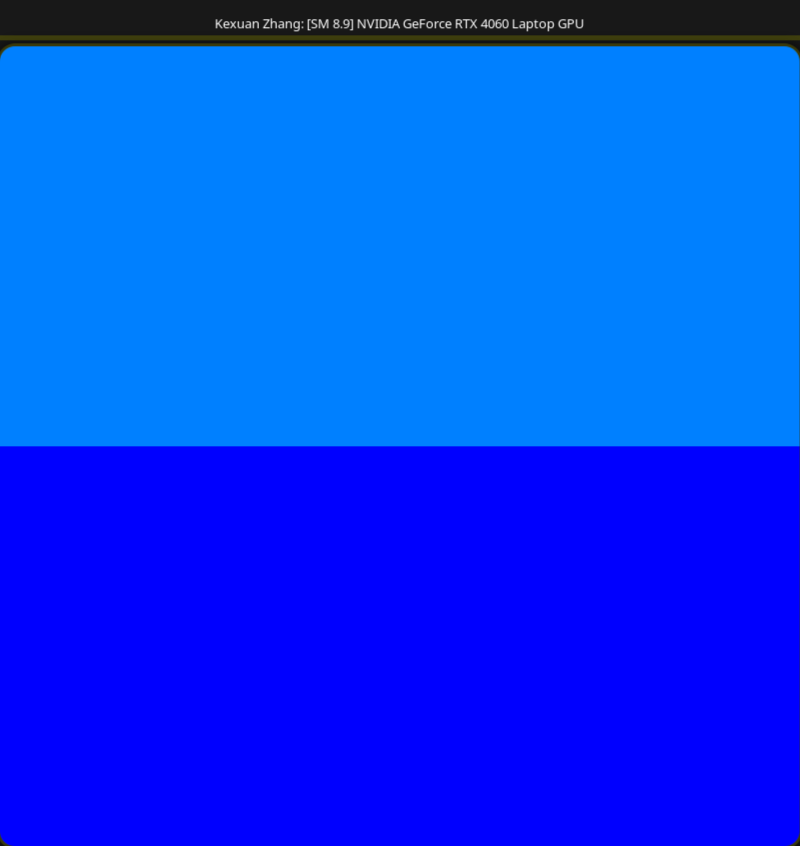
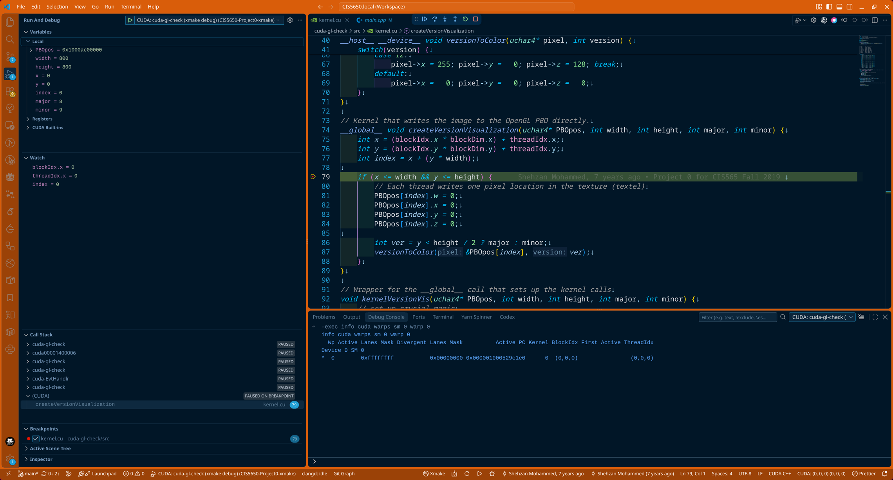
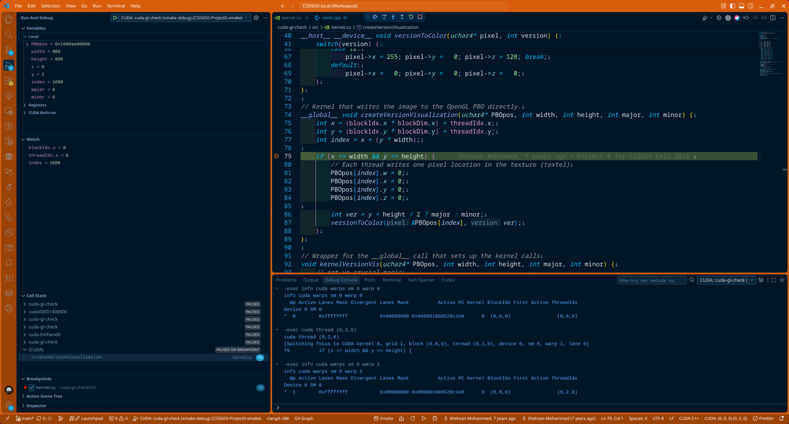
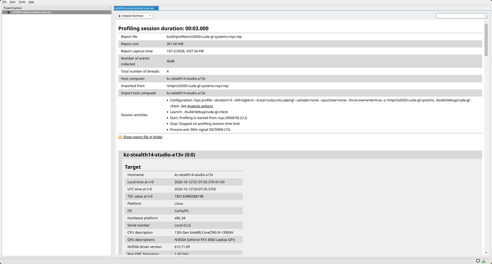
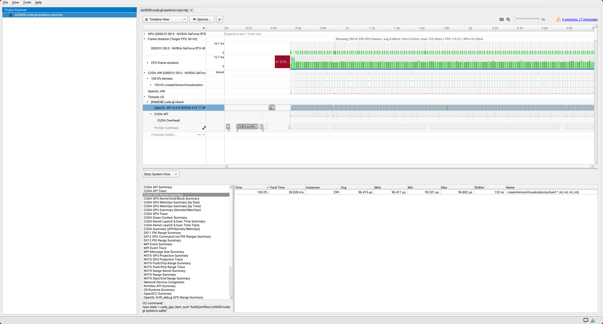
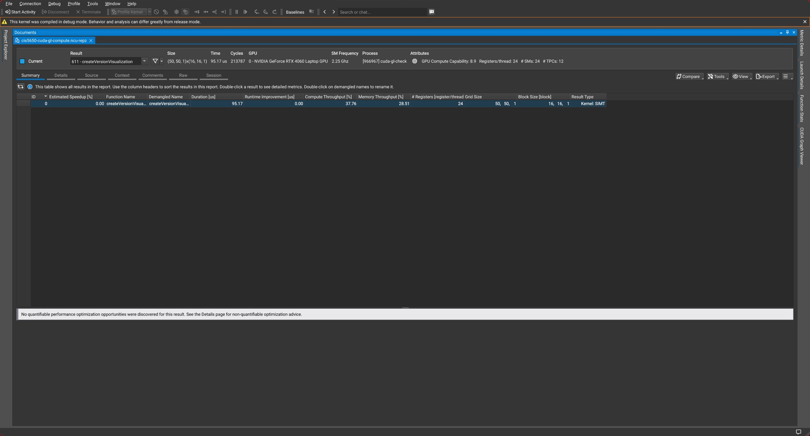
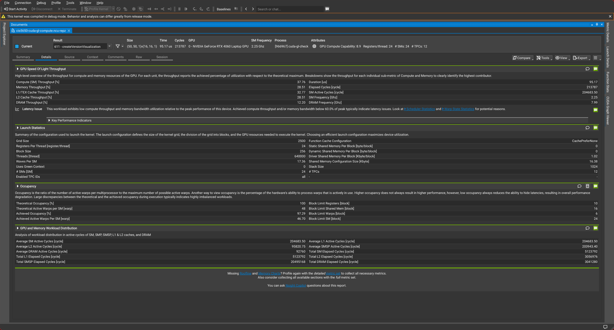
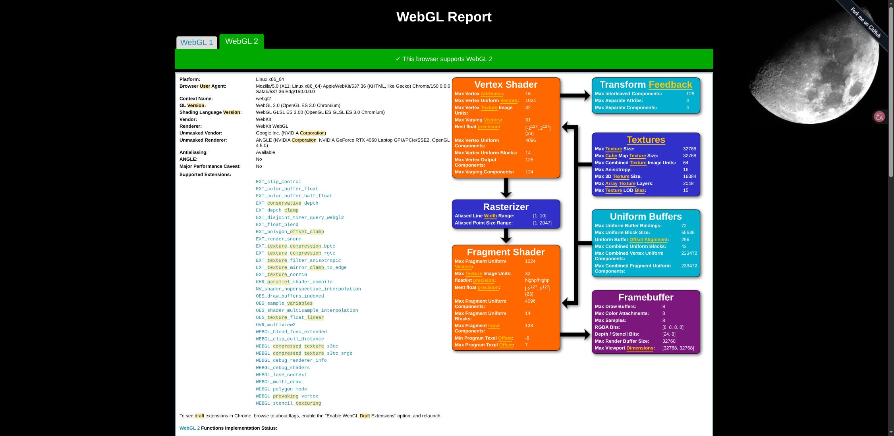
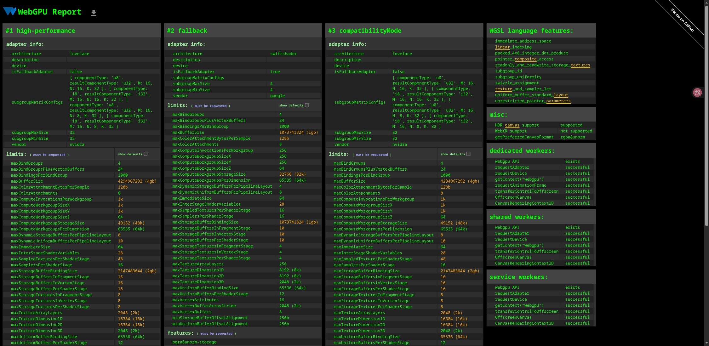

# Project 0 Getting Started

**University of Pennsylvania, CIS 5650: GPU Programming and Architecture, Project 0**

- Kexuan Zhang
- Personal laptop: CachyOS Linux, Intel Core i9-13900H, 32 GB RAM, NVIDIA GeForce RTX 4060 Laptop GPU (8 GB), CUDA 13.4, NVIDIA driver 615.71.09, xmake 3.1.1.
- Lab PC: Windows, Intel Core i7-14700, 32 GB RAM, NVIDIA GeForce RTX 4080 SUPER (16 GB), CUDA 13.3, NVIDIA driver 617.42.
- Development tools: xmake, VS Code with clangd and NVIDIA Nsight.

I am a University of Leeds PhD student, not a Penn student, following CIS 5650 independently to learn CUDA/GPGPU and understand GPUs more deeply. My prior graphics work used C++, GLSL, Slang, and Vulkan, with no CUDA experience. This repository is for personal study; no blog, LinkedIn, or other social media write-up is planned.

## Environment

The personal laptop running CachyOS Linux is the primary development machine.
Builds and runtime checks have also been validated on the Windows lab PC.
See [Windows Setup](WINDOWS_SETUP.md) for the tested commands and native Windows
debugging setup.

The project uses xmake for builds, clangd for completion and navigation, and Nsight in VS Code for Linux CUDA debugging. See [Linux Setup](LINUX_SETUP.md) for commands. Native Windows CUDA debugging uses Nsight Visual Studio Edition.

Open the shared VS Code workspace with `code CIS5650-Project0.code-workspace`.

CMake has been replaced by a root `xmake.lua` that includes both subprojects. CUDA paths and architecture are detected automatically, and the CUDA/OpenGL target handles the Linux rendering environment when run.

```sh
xmake f -m debug -y
xmake
xmake run cuda-gl-check
```

## Environment checks

### CUDA and OpenGL

The RTX 4060 Laptop GPU has compute capability **8.9 (`sm_89`)**. The check renders compute-capability colors through CUDA/OpenGL interoperability: dodger blue for major version 8 and blue for minor version 9.



### Nsight debugging

The GPU breakpoint at `kernel.cu:79` works in VS Code. Locals, Watch expressions, and the debug console show CUDA block, thread, and warp state.



Switching to thread `(0, 2, 0)` selects warp 1 and changes the pixel index to 1600.



### Nsight Systems

Use Systems to inspect CUDA/OpenGL activity over time. From the repository root, build Debug as above, then collect three seconds and open the report:

```sh
mkdir -p build/profiles
nsys profile --duration=3 --kill=sigterm --trace=cuda,nvtx,opengl \
  --sample=none --cpuctxsw=none --force-overwrite=true \
  --output=build/profiles/cis5650-cuda-gl-systems xmake run cuda-gl-check
nsys-ui build/profiles/cis5650-cuda-gl-systems.nsys-rep
```

The capture closes the application after three seconds. Exit code 143 is expected when it receives SIGTERM; check that the report was generated. CPU sampling and context-switch tracing are disabled for this GPU check.

1. Open **Analysis Summary** to check the GPU and collected events.
2. Switch to **Timeline View** and expand the CUDA hardware, CUDA API, and OpenGL rows. Select a kernel interval to inspect its duration and launch details.
3. Open **Stats System View** and select **CUDA GPU Kernel Summary** for launch counts and average duration.

A three-second capture recorded 299 kernel launches alongside OpenGL activity.





### Nsight Compute

Use Compute to inspect an individual kernel's hardware metrics. With the same Debug build:

```sh
mkdir -p build/profiles
ncu --target-processes all --set=basic --launch-count=1 --kill=yes \
  --force-overwrite --export=build/profiles/cis5650-cuda-gl-compute \
  xmake run cuda-gl-check
ncu-ui build/profiles/cis5650-cuda-gl-compute.ncu-repz
```

`--target-processes all` includes the application launched by xmake. Compute collects one kernel launch, replays it for the requested counters, then closes the application.

1. Select the kernel in **Summary** to see duration, SM throughput, and memory throughput.
2. Open **Details** and expand **Launch Statistics** and **Occupancy** to inspect grid/block dimensions and active warps.
3. For a more detailed capture, replace `--set=basic` with `--set=full`; collection takes longer.

Hardware metrics were collected successfully. The kernel uses a `(50, 50, 1)` grid with `(16, 16, 1)` blocks.





These Debug captures verify the profiling environment. For performance measurements, rebuild with `xmake f -m release -y` and `xmake`; Release includes CUDA line information without device debug instrumentation. Local reports are in `build/profiles/` and are ignored by Git. The commands above overwrite reports with the same names.

To launch either GUI without a report, run `nsys-ui` or `ncu-ui`, then use **File > Open** to load a saved capture. Both collection commands use the target's Linux rendering setup automatically. See the [Systems guide](https://docs.nvidia.com/nsight-systems/UserGuide/index.html) and [Compute guide](https://docs.nvidia.com/nsight-compute/NsightCompute/index.html) for other views.

### WebGL

WebGL 2 works in Microsoft Edge on Linux using the RTX 4060 Laptop GPU.



### WebGPU

WebGPU works in Edge on Linux. [WebGPU Report](https://webgpureport.org/) detects an NVIDIA Lovelace high-performance adapter with `isFallbackAdapter: false`. Adapter and device requests also succeed in dedicated, shared, and service workers. See [Linux browser setup](LINUX_SETUP.md#webgpu-in-edge) for the configuration steps.



## Progress

- [x] CUDA and OpenGL environment configured.
- [x] WebGL 2 and WebGPU browser checks passed.
- [x] SAXPY implemented and checked against the CPU result.
- [x] Transpose exercise.
- [x] Matrix multiplication exercise.

See [project instructions](INSTRUCTION.md), [CUDA introduction](cuda-introduction/README.md), and the [upstream project](https://github.com/CIS5650-Fall-2026/Project0-Getting-Started).
